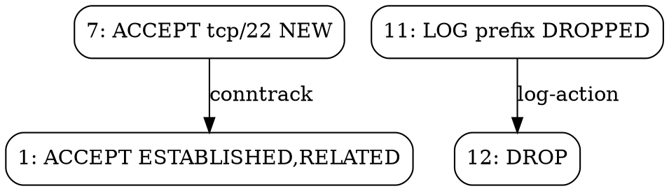

<!-- © AngelaMos | 2026 | 04-CHALLENGES.md -->

# Sfide di estensione

Queste sfide si basano sul codebase esistente di `fwrule`. Ciascuna fa riferimento a file e funzioni specifici in modo da sapere da dove iniziare. Presumono che tu abbia letto `models.v`, i parser, l'analyzer e il generator.

---

## Facili (1-2 ore ciascuna)

### 1. Aggiungere il supporto IPv6 a NetworkAddr

`ip_to_u32` in `src/models/models.v` converte stringhe dotted-quad in `u32`. Gli indirizzi IPv6 sono a 128 bit, quindi questo percorso fallisce completamente.

**Cosa fare:**

- Aggiungere `ip_to_u128` in `models.v`. V non ha un tipo u128 nativo, quindi usa due campi `u64` (metà superiore e metà inferiore).
- Aggiungere `cidr_contains_v6` con la stessa logica di shift e confronto sulla coppia u64. Gli shift inferiori a 64 toccano solo la metà superiore. Gli shift da 64 a 128 hanno bisogno di entrambe.
- Aggiornare `cidr_contains` per controllare `:` (IPv6) rispetto a `.` (IPv4) ed eseguire il dispatch di conseguenza.
- In `parse_network_addr` (`common.v`), rilevare `:` e impostare il `cidr` predefinito su 128 invece di 32. Le costanti `cidr_max_v4` e `cidr_max_v6` esistono già in `config.v`.
- Aggiornare `NetworkAddr.str()` per omettere il prefisso quando è uguale al valore predefinito per quella famiglia di indirizzi.

**File da modificare:** `src/models/models.v`, `src/parser/common.v`, `src/analyzer/conflict.v`

**Verifica con:**

```
2001:db8::/32 contains 2001:db8:1::/48       => true
2001:db8::/32 contains 2001:db9::/32          => false
::1/128 contains ::1/128                       => true
fe80::/10 contains 2001:db8::/32              => false
```

Attenzione (Gotcha): `::1` si espande in `0:0:0:0:0:0:0:1`. Il tuo parser deve gestire la sintassi abbreviata `::`.

---

### 2. Aggiungere un comando `stats`

Aggiungi un comando `stats` alla CLI che legge un ruleset e stampa: conteggio totale delle regole, regole per catena, regole per tabella, distribuzione dei protocolli e le prime 5 porte di destinazione.

**Cosa fare:**

- Aggiungere `'stats'` al matching dei sottocomandi in `main.v`, puntando a una nuova funzione `cmd_stats`.
- Caricare il ruleset tramite `load_ruleset(args[0])`, iterare su `rs.rules`, contare con `map[string]int` per ogni dimensione.

**File da modificare:** `src/main.v`

**Output atteso per `fwrule stats testdata/iptables_complex.rules`:**

```
Ruleset Statistics
  Total rules:  24
  Format:       iptables

  Rules by chain:
    INPUT        14
    FORWARD       4
    OUTPUT        3

  Protocol distribution:
    tcp          16
    udp           4
    icmp          2
```

---

### 3. Supportare il flag `--output` per l'esportazione su file

`cmd_export` e `cmd_harden` stampano su stdout. Aggiungi un flag `-o` / `--output` che scrive invece su un file.

**Cosa fare:**

- Entrambe le funzioni usano già `flag.new_flag_parser`. Aggiungi: `output_path := fp.string('output', \`o\`, '', 'write to file instead of stdout')`
- Dopo aver generato la stringa di output, controlla `output_path`. Se non è vuoto, usa `os.write_file(output_path, output)`. Se vuoto, usa `println(output)` come prima.
- Gestisci gli errori di scrittura con stderr e `config.exit_file_error`.

**File da modificare:** `src/main.v`

**Test:** `fwrule harden -s ssh,http -f nftables -o hardened.rules && cat hardened.rules`

---

### 4. Aggiungere il parsing delle regole SNAT/DNAT

Il gestore `-j` in `parse_iptables_rule` in `iptables.v` raccoglie tutto ciò che segue l'azione dentro `target_args` come stringa grezza. Quando l'azione è SNAT o DNAT, gli argomenti `--to-source` o `--to-destination` contengono l'indirizzo tradotto, ma quell'indirizzo non viene mai analizzato in dati strutturati.

Il modello include già `.snat` e `.dnat` nell'enum `Action` e `parse_action` li mappa correttamente.

**Cosa fare:**

- Aggiungere `nat_target ?NetworkAddr` a `Rule` in `models.v`.
- Nel gestore `-j`, quando l'azione è `.snat` o `.dnat`, esegui la scansione dei token alla ricerca di `--to-source` / `--to-destination` ed effettua il parsing con `parse_network_addr`. Gestisci il formato `address:port` suddividendo prima su `:`.
- Aggiornare `rule_to_iptables` in `generator.v` per emettere gli argomenti del target NAT.

**File da modificare:** `src/models/models.v`, `src/parser/iptables.v`, `src/generator/generator.v`

**Input di test:**

```
*nat
:PREROUTING ACCEPT [0:0]
:POSTROUTING ACCEPT [0:0]
-A POSTROUTING -o eth0 -j SNAT --to-source 203.0.113.1
-A PREROUTING -i eth0 -p tcp --dport 80 -j DNAT --to-destination 10.0.0.5:8080
COMMIT
```

Esegui il parsing e ri-esporta. Gli argomenti `--to-source` e `--to-destination` dovrebbero mantenere l'integrità durante il round-trip.

---

## Intermedie (3-6 ore ciascuna)

### 5. Importazione da sistema live

Esegui `iptables-save` o `nft list ruleset` come sottoprocesso e analizza direttamente l'output invece di leggere un file.

`os.execute()` di V restituisce un `os.Result` con `exit_code` e `output`. Quella stringa di output è ciò che i parser esistenti si aspettano.

**Cosa fare:**

- Aggiungere il flag `--live` a `cmd_analyze` in `main.v`. Quando impostato, salta l'argomento del file.
- Prova prima `iptables-save`. Se l'exit code è 0, passa `result.output` a `parse_iptables()`. Se fallisce, prova `nft list ruleset` e passalo a `parse_nftables()`. Se entrambi falliscono, stampa un messaggio che indica la necessità dei privilegi di root o di `CAP_NET_ADMIN`.

**File da modificare:** `src/main.v`, opzionalmente `src/parser/common.v`

**Utilizzo:** `sudo fwrule analyze --live`

---

### 6. Parsing di UFW/firewalld

Analizza l'output di stato di UFW o l'XML delle zone di firewalld nello stesso modello `Ruleset`.

**UFW:** Righe come `22/tcp  ALLOW IN  Anywhere` mappano a regole ACCEPT della catena INPUT. Rileva il formato UFW controllando se la prima riga non vuota inizia con `Status:`. Crea `src/parser/ufw.v`.

**firewalld:** L'XML di zona in `/etc/firewalld/zones/` contiene `<service name="ssh"/>` e `<port protocol="tcp" port="443"/>`. Mappa i servizi sulle porte tramite `config.service_ports`. Usa `encoding.xml` di V. Crea `src/parser/firewalld.v`.

**File da creare:** `src/parser/ufw.v` e/o `src/parser/firewalld.v`

**File da modificare:** `src/parser/common.v` (estendere `detect_format`)

---

### 7. Grafo delle dipendenze delle regole

Costruisci un grafo orientato in cui i nodi sono regole e gli archi sono dipendenze. Produci l'output in formato DOT per Graphviz.

**Tipi di dipendenza da rilevare:**

- **Conntrack**: qualsiasi regola con stato `.new_conn` dipende dalla regola ESTABLISHED,RELATED
- **Coppia Log-azione**: un LOG in posizione `i` si accoppia con un DROP/REJECT in `i+1`
- **NAT-filter**: DNAT in PREROUTING dipende da un ACCEPT in INPUT per la porta tradotta

**Output DOT atteso:**



**File da creare:** `src/graph/graph.v`

**File da modificare:** `src/main.v` (aggiungere il sottocomando `graph`)

---

### 8. Applicazione automatica dei fix

L'analyzer suggerisce correzioni sotto forma di testo. Costruisci un fixer che le applichi al ruleset effettivo.

**Tre operazioni:**

1. **Rimuovere i duplicati**: eliminare la seconda regola dai risultati "Duplicate rule"
2. **Riordinare le regole oscurate (shadowed)**: spostare la regola oscurata (più specifica) prima di quella oscurante (meno specifica)
3. **Inserire il conntrack mancante**: aggiungere un ACCEPT per ESTABLISHED,RELATED in posizione 1 quando segnalato

La difficoltà principale: i fix interagiscono tra loro. La rimozione della regola 5 sposta verso il basso di una posizione le regole 6+, invalidando gli indici negli altri risultati. Elabora i fix dall'indice più alto a quello più basso.

**Cosa fare:**

- Creare `src/fixer/fixer.v` con `pub fn apply_fixes(rs Ruleset, findings []Finding) Ruleset`
- Aggiungere il sottocomando `fix` in `main.v` che esegue l'analisi, applica i fix ed emette il ruleset corretto tramite il generator

**File da creare:** `src/fixer/fixer.v`

**File da modificare:** `src/main.v`

**Verifica:** `fwrule fix testdata/iptables_conflicts.rules -f iptables | fwrule analyze /dev/stdin` dovrebbe mostrare meno risultati.

---

## Avanzate (1-2 giorni ciascuna)

### 9. Analisi della copertura delle regole

Dati dei pacchetti di test, traccia quali regole ciascun pacchetto soddisfa e identifica le regole morte.

Definisci una struct `Packet` (`src_ip`, `dst_ip`, `protocol`, `dst_port`). Analizza un file contenente un pacchetto per riga. Scorri la catena per ogni pacchetto usando `cidr_contains` per gli IP e `port_range_contains` per le porte. La prima azione terminale che soddisfa la condizione vince (esattamente come netfilter). Traccia il conteggio degli hit per ciascuna regola.

**File di pacchetti di test:**

```
192.168.1.100  10.0.0.5  tcp  443
10.0.0.1       10.0.0.5  tcp  22
203.0.113.50   10.0.0.5  tcp  3306
```

**Output:** Conteggio degli hit per regola, elenco delle regole morte (zero hit), riepilogo accept/drop.

**File da creare:** `src/simulator/simulator.v`

**File da modificare:** `src/main.v` (aggiungere il sottocomando `simulate`)

---

### 10. Analisi temporale delle regole

Confronta due versioni di un ruleset e classifica ciascuna modifica in base all'impatto sulla sicurezza: aumento dell'esposizione (nuovo ACCEPT o DROP rimosso), riduzione dell'esposizione (nuovo DROP o ACCEPT rimosso), modifica del rate limit o modifica della policy.

Esegui il diff a livello semantico usando `criteria_equal` da `conflict.v` per il matching, non il confronto tra stringhe. Una modifica della policy da DROP ad ACCEPT su INPUT è sempre critica. L'aggiunta di un ACCEPT per una nuova porta costituisce un aumento dell'esposizione.

**Esempio di output:**

```
EXPOSURE INCREASE: Port 3306 (mysql) now accessible from 0.0.0.0/0
EXPOSURE DECREASE: SSH is now rate-limited
POLICY CHANGE: INPUT default changed from DROP to ACCEPT
Summary: 3 increase exposure, 1 decrease, 2 neutral
```

**File da creare:** `src/analyzer/audit.v`
 
**File da modificare:** `src/main.v` (aggiungere il sottocomando `audit`)

---

### 11. Replay di PCAP contro il ruleset

Analizza un file PCAP (header globale di 24 byte, header per pacchetto di 16 byte, poi dati grezzi del pacchetto). Estrai gli header Ethernet (14 byte), IP (IP sorgente/destinazione, protocollo) e TCP/UDP (porte). Riusa la logica di matching della Sfida 9 per simulare gli hit delle regole. Inizia solo con IPv4 TCP/UDP.

Due approcci: analizzare il binario direttamente in V, oppure usare l'interoperabilità C con libpcap.

**File da creare:** `src/simulator/pcap.v`

**File da modificare:** `src/main.v` (aggiungere il sottocomando `replay`)

---

### 12. Controllo di conformità al Benchmark CIS

Verifica un ruleset rispetto ai controlli del Benchmark CIS per i firewall Linux:

| Controllo | Requisito | Rilevamento |
|-----------|-----------|-------------|
| 3.5.1.1 | Default deny su INPUT | `rs.policies["INPUT"]` è `.drop` o `.reject` |
| 3.5.1.2 | Default deny su FORWARD | `rs.policies["FORWARD"]` è `.drop` o `.reject` |
| 3.5.1.3 | Loopback consentito | Regola con `in_iface == "lo"` e `.accept` |
| 3.5.1.4 | Sorgente loopback bloccata | Regola che blocca `127.0.0.0/8` su interfacce diverse da lo |
| 3.5.1.5 | Conntrack configurato | La regola ESTABLISHED,RELATED esiste |
| 3.5.1.6 | Logging dei drop | Regola LOG in catene con policy DROP |

**File da creare:** `src/analyzer/compliance.v`

**File da modificare:** `src/main.v` (aggiungere il sottocomando `compliance`)

---

## Per Esperti (Progetti di più giorni)

### 13. Rilevamento di conflitti tramite diagrammi di decisione binaria (BDD)

Sostituisci il confronto a coppie O(n^2) in `conflict.v` con un'analisi basata su BDD. Ogni bit di ogni campo del pacchetto (88 variabili BDD per IPv4: 32 src_ip + 32 dst_ip + 8 protocol + 16 dst_port) diventa una variabile BDD. Ogni regola diventa un BDD che è vero per i pacchetti corrispondenti. Oscuramento (shadowing): `B AND (NOT A)` è vuoto. Contraddizione: l'intersezione non è vuota con azioni opposte.

Implementa le operazioni BDD in V (`bdd_var`, `bdd_and`, `bdd_or`, `bdd_not`, `bdd_is_empty`) oppure usa l'interoperabilità C con BuDDy/CUDD.

**Ricerca:** Al-Shaer e Hamed, "Discovery of Policy Anomalies in Distributed Firewalls" (2004).

**File da creare:** `src/bdd/bdd.v`, `src/analyzer/bdd_conflict.v`

---

### 14. Analisi di firewall distribuiti

Analizza i ruleset di molteplici host per trovare problemi a livello di percorso. L'OUTPUT dell'Host A consente la porta 3306 verso l'Host B, ma l'INPUT dell'Host B la scarta (drop). Considerato singolarmente, nessuno dei due host sembra configurato male.

Formato di input: `hostname interface_ip ruleset_file` per riga. Per ogni coppia di host, controlla la raggiungibilità OUTPUT-consente rispetto a INPUT-consente. Riporta i risultati per coppia e per porta. Fai attenzione al NAT che trasforma gli indirizzi a metà percorso.

**File da creare:** `src/analyzer/distributed.v`, `src/topology/topology.v`

**File da modificare:** `src/main.v` (aggiungere il sottocomando `topology`)

---

### 15. Monitoraggio delle regole in tempo reale

Interroga `iptables -L -v -n` a intervalli regolari (valore predefinito 5s), analizza i contatori di pacchetti/byte, calcola i delta e mantieni una finestra mobile di 60 campioni. Invia un alert quando: una regola a zero hit inizia a ricevere hit, una regola supera di 2 volte la sua media mobile, oppure una regola DROP accumula hit rapidamente.

```
[14:32:15] ALERT: Rule 5 (DROP tcp/3306) spike: 847 pkts/5s (avg: 2 pkts/5s)
[14:32:20] ALERT: Rule 3 (ACCEPT tcp/22) spike: 312 pkts/5s (avg: 8 pkts/5s)
```

**File da creare:** `src/monitor/monitor.v`

**File da modificare:** `src/main.v` (aggiungere il sottocomando `monitor`)

---

### 16. Verifica formale con SMT Solver

Codifica le regole come vincoli bitvector SMT e usa Z3 per dimostrare proprietà come "nessun traffico esterno raggiunge la porta 3306". Se UNSAT, la proprietà è verificata. Se SAT, Z3 fornisce il pacchetto specifico che la viola.

Codifica la valutazione della catena come if-then-else annidati sulle formule di matching delle regole. Usa l'interoperabilità C di V per l'API C di Z3, oppure invoca la shell con input SMT-LIB2.

**Ricerca:** Kazemian et al., "Header Space Analysis: Static Checking for Networks" (2012).

**File da creare:** `src/verifier/verifier.v`, `src/verifier/smt.v`

**File da modificare:** `src/main.v` (aggiungere il sottocomando `verify`)

---

## Come affrontare queste sfide

- Scegline una da ciascun livello man mano che procedi
- Scrivi prima i test (almeno 5 casi per sfida) in `src/<module>/<module>_test.v`
- Segui il pattern esistente: i modelli definiscono i dati, i parser consumano il testo, gli analyzer producono i finding, i generator producono il testo
- Esegui `v fmt -w src/` e `v test src/` dopo ogni modifica
- Se una sfida sembra troppo grande, scomponila in parti più piccole e testa ciascuna parte in modo indipendente